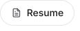
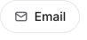
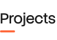
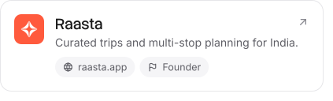
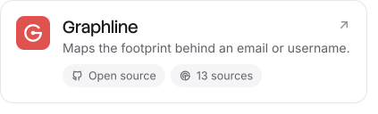
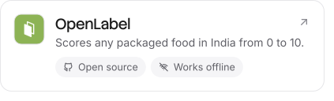

<picture><source media="(prefers-color-scheme: dark)" srcset="assets/intro-dark-69a0081a.svg"></picture>

I like getting to the bottom of a problem before touching the screens. I handle the whole thing, from research and flows to the interface and the design system behind it, and I build my own products with AI.

<picture><source media="(prefers-color-scheme: dark)" srcset="assets/label-projects-dark-11850394.svg"></picture>

