<picture>
  <source media="(prefers-color-scheme: dark)" srcset="assets/header-dark.svg">
  
</picture>

Product designer in Lucknow, four years in. Most recently a year at Dinnova AG in Switzerland, designing seven web and mobile products. Before that, freelance work for clients in 24+ countries, rated 5.0 across 31 reviews.

[Raasta](https://raasta.app), a travel platform for India that I founded 
[Graphline](https://github.com/armaanux/graphline), an OSINT tool that maps the footprint behind an email, phone or username 
[OpenLabel](https://github.com/armaanux/openlabel), an offline scanner that scores packaged food in India from 0 to 10

Open to full-time roles, remote or relocating.

[armaanux.in](https://armaanux.in) · [Resume](https://armaanux.in/Armaan-Parvez-Product-Designer-Resume.pdf) · [LinkedIn](https://www.linkedin.com/in/armaanux) · [Peerlist](https://peerlist.io/helloarmaanux)
