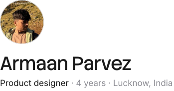
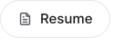
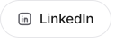
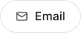

<picture>
  <source media="(prefers-color-scheme: dark)" srcset="assets/intro-dark-d6e58231.svg">
  
</picture>

I like to understand a problem before I open Figma, I stay close to product and engineering until it ships, and I use AI every day to research, test ideas and build my own products, but the design calls are always mine.

  
  
  
  

